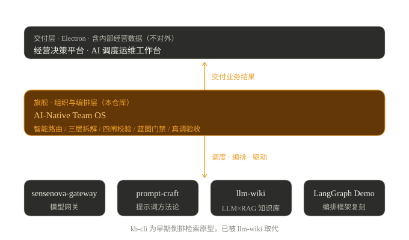
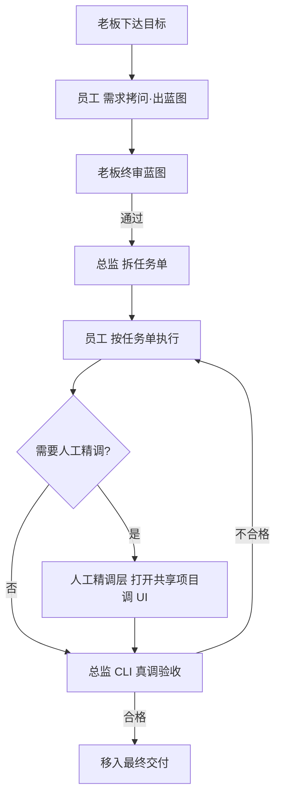

# AI-Native Team OS

> **一整套「把业务诉求变成生产级 AI 系统」的开源工具链旗舰（umbrella）。**
> 本仓库是这套体系的**组织与编排总装层**；它下面挂着 6 个开源组件 + 2 个桌面软件，全部来自同一套 45+ 家门店的真实生产环境。想找"某个单点工具"请看下方[体系组件全景](#体系组件全景一张表看全)；想理解"怎么把一堆 AI 工具变成一条生产线"，核心就在本仓库。

> 一套真实运行过的「AI 原生组织」操作系统：1 个老板 + 数十个 AI Agent 角色 + 多个 AI 工具协作，通过智能路由、任务拆解、协作评审、自动化调度，把模糊业务诉求转成可量化业务结果。本文档是通用化、脱敏后的方法论版本。原体系在某连锁零售品牌真实运行，已覆盖 40+ 自动化任务、数十个角色、多部门协作、多 AI 工具真实分工（总监/员工/人工精调三层）。

> 📌 **技术关键词**：Agent 编排 / 多智能体 / Skill 体系 / 工作流 / MCP 工具集成 / RAG / 模型服务架构 —— 覆盖多智能体协作与工作流编排的完整落地路径。

---

## 全家桶架构（一张图看全）



## 体系组件全景（一张表看全）

| 层级 | 组件 | 在这一体系里的角色 | 公开状态 |
|---|---|---|---|
| **组织与编排（旗舰 · 本仓）** | [ai-native-team](https://github.com/Babymrbbbb/ai-native-team) | 把 AI 工具变成生产线的组织 OS：路由/拆解/验收/防失控 | 开源 |
| 编排对照 | [langgraph-agent-demo](https://github.com/Babymrbbbb/langgraph-agent-demo) | 编排思想用 LangGraph 状态机的工业框架等价复刻 | 开源 |
| 模型层 | [sensenova-gateway](https://github.com/Babymrbbbb/sensenova-gateway) | 多 key 池化 + 限流降级的模型调用底座 | 开源 |
| 方法层 | [prompt-craft](https://github.com/Babymrbbbb/prompt-craft) | 提示词工程方法论（图像 + 视频） | 开源 |
| 知识层 | [llm-wiki](https://github.com/Babymrbbbb/llm-wiki) | LLM×RAG 双轨知识库（kb-cli 的演进） | 开源 |
| 知识层 · 早期 | [kb-cli](https://github.com/Babymrbbbb/kb-cli) | 倒排检索原型，验证"分层 + 召回优先" | 开源 |
| 交付层 | 经营决策平台 / 驾驶舱 | Electron 经营看板，覆盖 45+ 店全量数据 | 含内部数据 · 不对外 |
| 交付层 | AI 调度运维工作台 | Electron 运维控制台，服务一键启停 | 含内部数据 · 不对外 |

> 交付层两个桌面软件含品牌内部经营数据，源码不对外；其架构与设计决策以后续公开文档形式呈现。

---

## 为什么做这个

AI 落地真正的瓶颈不是"模型不够强"，而是**组织怎么消化 AI**。单个 Prompt 写得好只能解决单个问题；要让 AI 持续产出业务结果，需要一套可运行的组织机制：

- 谁负责什么、谁能决策什么
- 需求来了怎么路由到正确的角色
- 任务怎么拆解、怎么审核、怎么验收
- 跨部门怎么协作、冲突怎么裁决
- 知识怎么学习、沉淀、复用
- 自动化怎么调度、怎么防止失控
- **多个 AI 工具怎么物理分工、怎么防止互相覆盖**

本仓库把这一套机制以**通用化、脱敏后的方法论**形式公开，分 11 个模块。生产实现（含品牌专属角色、自动化任务实例）为独特自研改造，不对外开源。

## 仓库结构

```
ai-native-team/
├── README.md                    # 总览（本文件）
└── docs/
    ├── 01-org-design.md        # 组织架构：三层设计（决策/管理/执行）
    ├── 02-routing.md           # 智能路由：需求 → 角色 5 步判断
    ├── 03-task-sop.md          # 任务拆解 SOP（CEO/主管/专员三层）
    ├── 04-collab.md            # 协作机制：互评/闭门会/过审/请示
    ├── 05-meetings.md          # 会议机制：晨会/晚复盘/周会/月度复盘
    ├── 06-learning.md         # 员工自主学习机制
    ├── 07-supervision.md        # 主管监督与反馈机制
    ├── 08-decisions.md         # 决策边界与分层审批
    ├── 09-automation.md        # 自动化运行清单（44 个任务实例）
    ├── 10-assistant.md         # CEO 助理：流程雷达设计
    └── 11-multi-agent-collab.md # 多 AI 工具协作：总监/员工/人工精调 + 文件夹隔离 + 蓝图门禁 + 真调验收
```

## 核心概念速览

| 概念 | 一句话 |
|---|---|
| **智能路由** | 用户只下指令，系统自动判断角色/机制/层级 |
| **三层拆解** | CEO 拆方向、主管拆动作、专员拆步骤 |
| **员工互评** | 跨部门任务至少 2 个视角评审，冲突留到闭门会 |
| **决策边界** | ≤1 万自决、1-5 万报备、>5 万请示 |
| **自动化** | 44 个定时任务覆盖 晨会/周报/巡检/学习/竞品 |
| **四闸校验** | 填写闸/术语闸/驳回闸/反勾结闸 —— 防 AI 产出空壳件 |
| **多工具协作** | 总监写码验收 / 员工执行 / 人工精调 UI，文件夹物理隔离 |
| **蓝图门禁** | 搭系统前必须先出一页蓝图、老板终审，再拆任务单 |
| **真调验收** | 验收必须由总监 CLI 真实执行，严禁"同款模型扮演总监" |

## 多工具协作总览



## 本仓库怎么带动整个体系

- 调度 **sensenova-gateway** 的模型配额，支撑 44 个自动化任务
- 编排 **prompt-craft** 的内容生产工作流
- 驱动 **llm-wiki** 的知识库每日维护自动化
- 用 **langgraph-agent-demo** 把编排思想与工业框架做架构同构对照
- 产出结果落到 **经营决策平台 / 运维工作台** 交付给业务方

**单独用的价值**：即使不接入其他组件，任何想「让多个 AI Agent 协作干活」的团队都能直接用这套组织机制——角色分工、任务拆解、质量门禁、防失控。

## 适用场景

- 正在搭建「AI Agent 团队」来支撑业务的人
- 想知道 AI 怎么从"玩具 Demo"变成"业务生产线"的人
- 做 AI 落地交付的工程师 / 顾问（AI Solutions / 企业 AI 落地）
- 对"AI 原生组织"感兴趣的管理者
- 需要编排多个 AI 工具（编码 Agent / 内容 Agent / IDE）的人

## License

MIT
