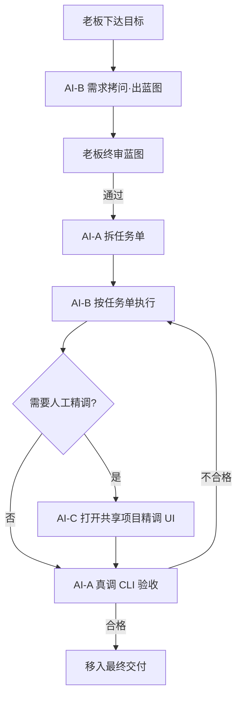
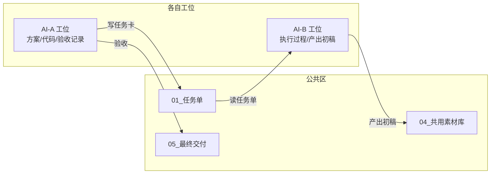
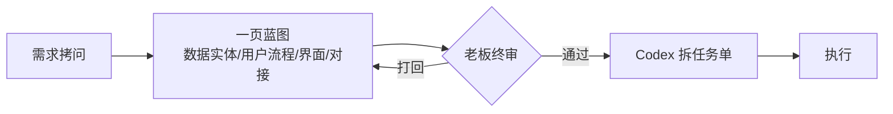

# 11 · 多 AI 角色协作：总监 / 员工 / 人工精调三层

> 这是把「AI 原生团队」从**单会话角色模拟**升级到**多工具真实协作**的一层。多个 AI 工具各自承担不同角色，通过「任务卡 + 文件夹隔离 + 真调验收」形成完整闭环。

## 为什么需要多 AI 协作

单个 AI 会话里的角色（CEO/主管/专员）本质是**角色模拟**——同一个模型按不同 prompt 扮演不同身份。当任务需要真正写代码、改文件、人眼精调 UI 时，需要**不同的 AI 工具**物理分工：

| 工具 | 角色 | 擅长 | 不擅长 |
|---|---|---|---|
| **AI-A（总监/技术合伙人）** | 拆任务单、写代码、验收 | 全自动、可脚本化 | 审美判断、实时交互 |
| **AI-B（员工）** | 按任务单执行、查资料、出报告、批量处理 | 内容生产、数据整合 | 独立验收（写审分离） |
| **AI-C（人工精调层）** | 打开共享项目，人工实时调 UI/交互/审美 | 人眼判断、边看边调 | 批量自动化 |

**核心分工**：
- 批量写代码、脚手架、重构、跑测试 → **AI-A**（全自动，结果回 stdout）
- 需求梳理、调研、蓝图、数据整合 → **AI-B**
- 需要人实时看、边看边调 → **AI-C**

## 协作闭环流程



## 文件夹隔离宪法（多工具协作的命根子）

**问题**：多个 AI 工具如果都往同一个目录写，会互相覆盖、分叉、越权。

**方案**：每个工具只允许读写自己的文件夹，公共目录只放任务卡和结果索引。

| 工具 | 只允许访问 | 禁止访问 |
|---|---|---|
| AI-A（总监） | 任务单 / 自己的工位 / 最终交付 / 每日复盘 | 员工工作区、用户个人目录 |
| AI-B（员工） | 自己工作区 / 共享素材 / 任务单 / 最终交付 | 总监工作区、用户个人目录 |
| AI-C（精调） | 共享项目目录（看板/网站） | 团队协作目录、用户个人目录 |

**四条铁律**：
1. 每个工具只允许读/写自己的文件夹，不得越界
2. 公共目录只放任务卡、素材、最终结果
3. 临时文件、诊断脚本、中间产物必须留在自己工作区
4. 所有跨工具交接，走「任务卡 + 结果文件」，禁止直接改对方文件夹



## 蓝图门禁（搭系统必走）

**触发**：任何「搭系统 / 网站 / 后台 / 工具 / 自动化」类任务。

**规则**：拆任务单前必须先产「一页蓝图」（4 组件：数据实体 / 用户流程 / 关键界面 / 外部对接，方框箭头即可），交老板终审确认后才能写任务单。无蓝图的搭系统任务单不允许下发。

**为什么**：直接写实现步骤 = Big Bang，必返工。蓝图让"接口契约 / 模块划分 / 技术选型"在写码前对齐。



## 真调验收门禁（写审分离）

**规则**：
1. **写审分离**：写的人和审的人不是同一个（默认 AI-A 审、AI-B 写）
2. **验收必须由 AI-A 的 CLI 完整链路真实执行**，严禁用「同款模型扮演总监」代替真 CLI 验收
3. **AI-A 不可用时不得冒充**：明确报告「验收待补」，不能伪造验收记录
4. **自测 ≠ 验收**：执行方的 selftest 是自测，不是验收；验收结论必须由 AI-A CLI 独立给出

**验收闭环**：
```
执行方产出初稿
    ↓
AI-A CLI 真实执行验收（对照合格标准 + 蓝图偏离检查）
    ├─ 合格且未偏离 → 移入最终交付
    └─ 不合格 / 偏离蓝图 → 写明问题打回 → 回到执行
```

## 任务单必备项（5 项，搭系统类必含蓝图）

每条任务单必须写清：
1. **素材**（用哪些文件，在哪）
2. **输入/输出文件**（读什么、产出什么、放哪）
3. **执行步骤**（基于蓝图拆）
4. **合格标准**（可打勾、可判断，不写"高级/好看"这类模糊词；搭系统类须含「蓝图偏离检查」）
5. **蓝图**（搭系统类必填：4 组件一页图 + 老板已确认；纯内容/文案类填"无"）

## 铁律

- 写审分离：写的人和审的人不是同一个
- 找不到就说，不许编
- 关键、对外、支付、安全 → 老板终审
- 架构决策（一页蓝图）属老板终审项：AI 可起草蓝图，但不得单方面拍板架构
- 改动要留痕：重要改动写进任务单或复盘